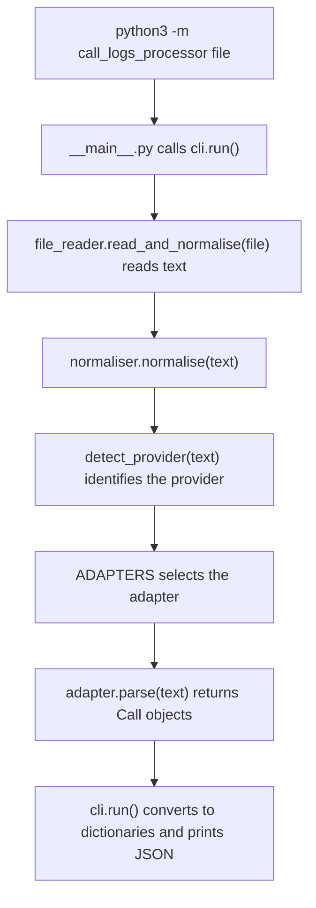

# Universal call-log normaliser

Convert Asterisk CDR CSV, Twilio REST JSON/status callbacks, and RingCentral Call Log JSON into the same nine-field `Call` model. The provider is detected from the input contents.

Requires Python 3.10+. The project uses the Python standard library and the timezone data available to `zoneinfo`. No package installation is needed when running from this repository.

## Run with a file

Run these commands from the repository root, the directory containing this README:

```bash
python3 -m call_logs_processor tests/fixtures/asterisk.csv
python3 -m call_logs_processor tests/fixtures/twilio_rest.json
python3 -m call_logs_processor tests/fixtures/twilio_webhooks.json
python3 -m call_logs_processor tests/fixtures/ringcentral.json
```

Pass one file path. There are no provider or configuration flags. `-m` runs the package through `call_logs_processor/__main__.py`.

The CLI reads the complete UTF-8 file, detects its format, normalises its records, and prints a JSON array. It processes local input without making API requests or downloading recordings.

The first item produced by the Twilio REST fixture is:

```json
{
  "id": "CA00000000000000000000000000000001",
  "start": "2026-10-24T08:00:00Z",
  "end": "2026-10-24T08:01:00Z",
  "direction": "inbound",
  "caller": "+442079460001",
  "callee": "+442079460002",
  "extension": null,
  "status": "completed",
  "recording": null
}
```

To save the output to a file:

```bash
python3 -m call_logs_processor tests/fixtures/twilio_rest.json > normalised.json
```

The command creates or replaces `normalised.json`. Success returns exit code `0`. Missing files, invalid encodings, unsupported formats, and invalid records produce an error on stderr and exit code `2`. JSON is printed only after processing succeeds, so errors do not produce partial JSON output.

## Use from Python

For a file, call `read_and_normalise(file)` with a string path or a `Path` object:

```python
from call_logs_processor.file_reader import read_and_normalise

calls = read_and_normalise("tests/fixtures/twilio_rest.json")

print(calls[0].caller)
print(calls[0].to_dict())
```

The function returns a list of `Call` objects. It does not print or save the results.

For data already read into memory, call `normalise(payload)`:

```python
from pathlib import Path

from call_logs_processor.normaliser import normalise

payload = Path("tests/fixtures/asterisk.csv").read_text(encoding="utf-8-sig")
calls = normalise(payload)

print(calls[0].to_dict())
```

`normalise` takes only the input data and always detects the provider. It accepts text, UTF-8 bytes, decoded JSON dictionaries/lists, or text streams. URL-encoded Twilio callback bodies are also supported.

Invalid data raises `NormalisationError`. File reading can also raise filesystem or encoding errors; the CLI handles these and prints their messages.

## Execution flow and file layout



| File | Responsibility |
| --- | --- |
| `call_logs_processor/__main__.py` | Starts the CLI and returns its exit code |
| `call_logs_processor/cli.py` | Reads the filename argument, prints JSON, and reports errors |
| `call_logs_processor/file_reader.py` | Reads the file and passes its contents to `normalise` |
| `call_logs_processor/normaliser.py` | Selects the detected provider's adapter using the module-level `ADAPTERS` constant |
| `call_logs_processor/detection.py` | Recognises CSV, JSON, and callback field signatures |
| `call_logs_processor/models.py` | Defines `Call`, `Direction`, `Status`, validation, and JSON-ready conversion |
| `call_logs_processor/adapters/` | Contains one adapter per provider |
| `call_logs_processor/adapters/_common.py` | Shares text, ID, direction, timestamp, and JSON parsing between adapters |
| `call_logs_processor/errors.py` | Defines `NormalisationError` |
| `call_logs_processor/__init__.py` | Exposes the public imports |
| `tests/` | Contains regression tests and synthetic provider fixtures |

Timezone setup belongs to the Asterisk adapter. RingCentral's duration and nested-object helpers belong to the RingCentral adapter.

## Output model

Every adapter returns these fields:

| Field | Python value | Meaning |
| --- | --- | --- |
| `id` | `str` | Provider record ID or deterministic Asterisk fallback |
| `start` | `datetime` or `None` | Call start in UTC, when available |
| `end` | `datetime` or `None` | Call end in UTC, when available |
| `direction` | `Direction` | `inbound`, `outbound`, `internal`, or `unknown` |
| `caller` | `str` or `None` | Source number or party identifier |
| `callee` | `str` or `None` | Destination number or party identifier |
| `extension` | `str` or `None` | Local extension number when known |
| `status` | `Status` | Normalised lifecycle state or result |
| `recording` | `str` or `None` | Supplied recording URL or path |

`Call` is immutable. It validates field types and timezone-aware timestamps, converts timestamps to UTC, and rejects an end before the start.

`to_dict()` converts dates to ISO 8601 strings ending in `Z`, enums to strings, and missing values to JSON nulls. Party identifiers retain their original representation with surrounding whitespace removed; country codes are not guessed.

Statuses are `queued`, `initiated`, `ringing`, `in-progress`, `completed`, `busy`, `no-answer`, `failed`, `canceled`, `rejected`, `voicemail`, and `unknown`. Unrecognised provider statuses or directions become `unknown`.

## Automatic format detection

| Input | Signature |
| --- | --- |
| Asterisk headered CSV | Headers include `src`, `dst`, `start`, and `disposition`, in any order |
| Asterisk headerless CSV | 16, 17, 18, or 21 columns, with a call-start timestamp in the tenth column |
| Twilio REST JSON | A `calls` collection or `sid` field |
| Twilio callback JSON | A `CallSid` field |
| Twilio callback form body | A `CallSid` or `CallStatus` form field |
| RingCentral JSON | A `records` collection or `startTime` field |

JSON keys and headerless timestamp shapes are matched using regexes. Detection inspects record/page keys, so provider-like text inside caller names, URLs, or unrelated metadata does not change the selected adapter.

Unknown or mixed-provider input raises `NormalisationError`. Empty `calls`/`records` envelopes are detectable; bare empty arrays and blank files have no format signature and are rejected. Adapter validation runs after detection.

## UK timezones

Asterisk timestamps without an offset default to `Europe/London`, including in the file-only CLI flow. GMT and BST are applied according to the timestamp's date.

| Asterisk local time | UTC output |
| --- | --- |
| `2026-01-15 09:00:00` (GMT) | `2026-01-15T09:00:00Z` |
| `2026-07-15 09:00:00` (BST) | `2026-07-15T08:00:00Z` |

An explicit source offset determines the instant before conversion to UTC. Twilio and RingCentral timestamps must include a timezone when present; the UK default is only applied to Asterisk timestamps without an offset.

During the autumn clock change, `2026-10-25 01:30:00` occurs twice. Use `2026-10-25T01:30:00+01:00` for the BST occurrence or `2026-10-25T01:30:00+00:00` for the GMT occurrence. During the spring change, `2026-03-29 01:30:00` does not exist in UK local time. Ambiguous or nonexistent local timestamps are rejected with an error naming the affected field.

To display a normalised timestamp in UK local time:

```python
from zoneinfo import ZoneInfo

if calls and calls[0].start is not None:
    print(calls[0].start.astimezone(ZoneInfo("Europe/London")).isoformat())
```

See [Python's zoneinfo documentation](https://docs.python.org/3.10/library/zoneinfo.html) and the [UK clock-change dates](https://www.gov.uk/when-do-the-clocks-change).

## Provider behaviour

### Asterisk CDR CSV

Supports the classic 16 columns, 17 columns with `uniqueid`, 18 with both `uniqueid` and `userfield`, and the 21-column layout adding `peeraccount`, `linkedid`, and `sequence`. Headered exports can reorder fields and include explicit `direction`, `extension`, and `recordingfile` values.

Each CDR row produces one Call. IDs use `uniqueid`, suffixed with `:sequence` when present. Missing IDs use a stable hash of the row; identical rows have identical fallback IDs. Records are not aggregated or deduplicated.

Classic CDR CSV has no universal direction field. Without explicit direction data or configured PBX rules, direction stays `unknown`. Recording paths come from `recordingfile` by default; `userfield` is not assumed to contain a recording.

For custom PBX rules, configure the adapter directly:

```python
from pathlib import Path

from call_logs_processor.adapters.asterisk import AsteriskCDRAdapter

payload = Path("tests/fixtures/asterisk.csv").read_text(encoding="utf-8-sig")

adapter = AsteriskCDRAdapter(
    extensions={"201", "202", "203"},
    inbound_contexts={"from-trunk"},
    outbound_contexts={"from-internal"},
)
calls = adapter.parse(payload)
```

An explicit source direction takes precedence, followed by both parties being internal, a configured context, then a recognised internal party.

For a PBX logging timezone-less UTC timestamps, use `AsteriskCDRAdapter(timezone="UTC").parse(payload)`. For other headerless layouts, configure `fieldnames`; a lone optional column otherwise means `uniqueid`. `recording_field` selects a custom recording column. These settings belong to the adapter constructor.

### Twilio REST JSON and status callbacks

Accepts a REST call resource, a `calls` response, a list of records, or callback fields in JSON/form data. `outbound-api` and `outbound-dial` map to `outbound`. Extension stays null.

REST start/end times come directly from `start_time`/`end_time`. For callbacks, `Timestamp` supplies the start for `initiated` and the end for terminal statuses. Explicit `StartTime`/`EndTime` fields in enriched callback data take precedence. Missing times stay null; connected duration is not used to invent a call start.

Callbacks remain individual snapshots. Repeated `CallSid` values are preserved without ordering, reconciliation, or deduplication.

Recording comes from callback `RecordingUrl` or enriched REST `recording_url`. A REST recording collection URL is not used as an audio URL. The calling application handles webhook signature verification and fetching subsequent REST pages.

### RingCentral Call Log JSON

Accepts a record, a list of records, a page containing `records`, or an array of exported pages. Each top-level voice record produces one Call. Nested `legs` are not duplicated; non-voice records are skipped.

End time is `startTime + durationMs`, falling back to `duration` in seconds. Active calls and records without duration have a null end.

The local extension comes from `to.extensionNumber` for inbound calls or `from.extensionNumber` for outbound calls, falling back to `extension.extensionNumber`. Extension IDs are not extension numbers. Recording comes from `recording.contentUri`.

`RingCentralAdapter.parse_pages(pages)` also accepts an iterable of exported pages. For live pagination, use `iter_calls(first_page, fetch_page)`: your `fetch_page(uri)` function must fetch and return decoded JSON or a JSON body. The adapter follows `navigation.nextPage.uri` and detects cycles or advertised pages without a next link. Authentication, retries, and rate limits belong to the supplied client.

The CLI processes only the pages included in its input file.

## Tests and fixtures

Run the suite from the repository root:

```bash
python3 -m unittest discover -v
```

| Fixture | Content |
| --- | --- |
| `tests/fixtures/asterisk.csv` | Classic CDR rows with answered, busy, unanswered, and extension-to-extension calls |
| `tests/fixtures/twilio_rest.json` | REST call-list response |
| `tests/fixtures/twilio_webhooks.json` | Initiated, ringing, in-progress, and completed callbacks for one call |
| `tests/fixtures/ringcentral.json` | Two linked pages, including a record with nested legs |

Fixtures are synthetic. Tests cover format selection, provider mappings, shared model validation, UK clock changes, pagination, malformed input, and CLI output/error handling.

## Provider references

- [Asterisk CDR specification](https://docs.asterisk.org/Configuration/Reporting/Call-Detail-Records-CDR/CDR-Specification/) and [CSV implementation](https://github.com/asterisk/asterisk/blob/master/cdr/cdr_csv.c).
- [Twilio Call resource and status callbacks](https://www.twilio.com/docs/voice/api/call-resource).
- [RingCentral detailed call-log data](https://developers.ringcentral.com/guide/voice/call-log/details).
